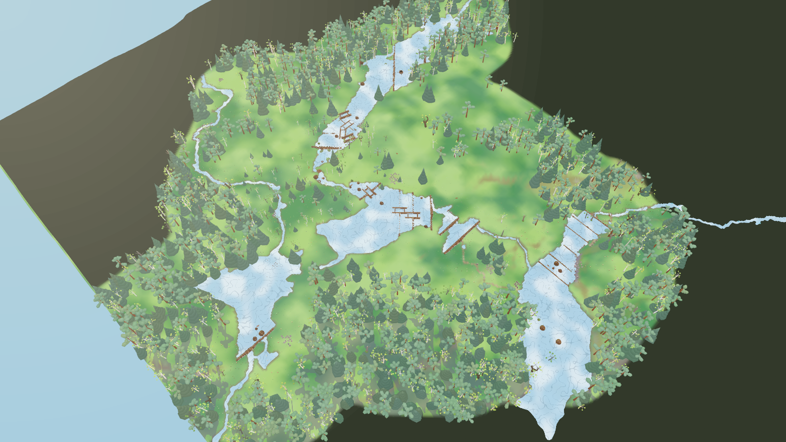
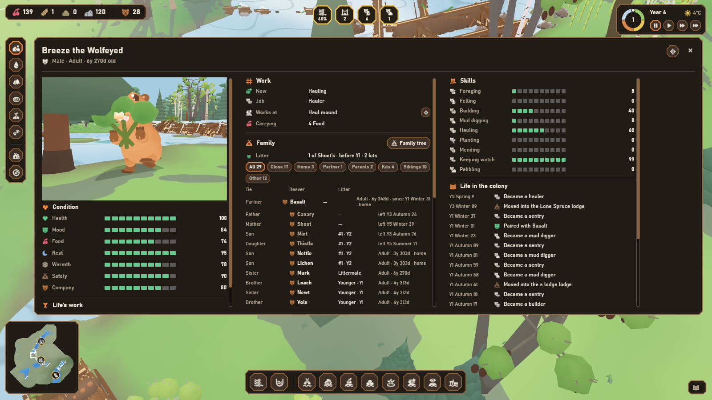
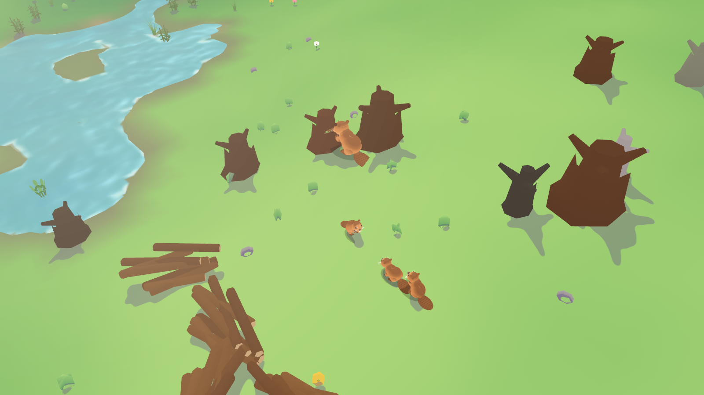
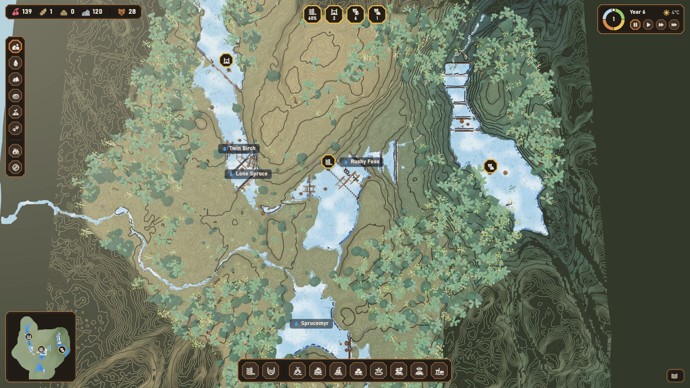
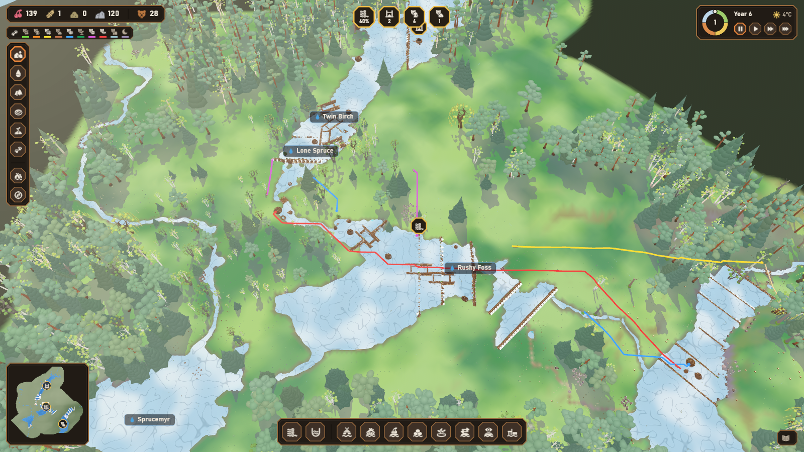
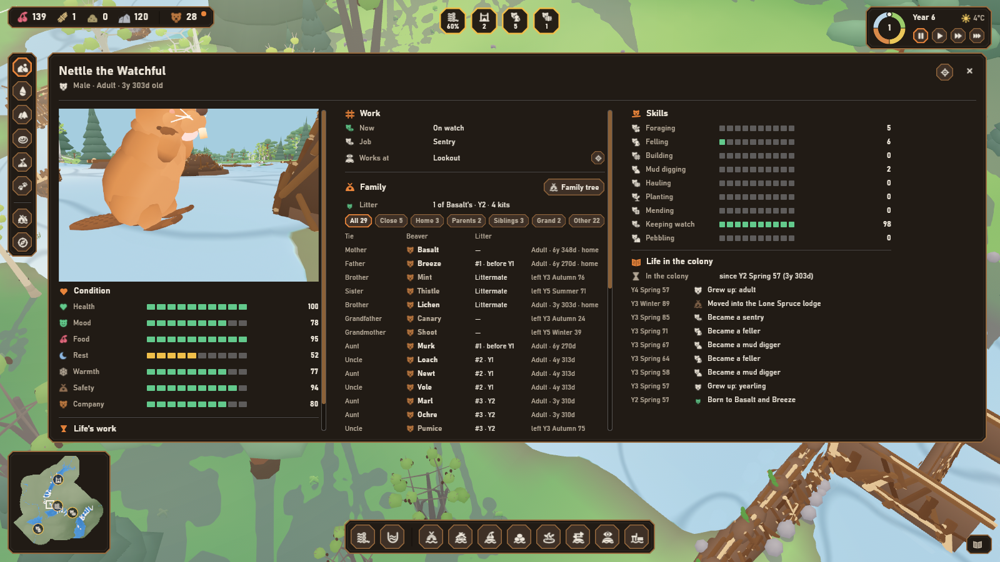

# Beaver Colony

A beaver colony builder and river simulation. Dam streams, flood valleys into ponds, dig canals and locks, manage timber and food through the seasons, and keep your families safe from wolves.

## How to Play

Double-click **beaver_colony.exe** to start playing.

---

## Game

Beaver themed survival city builder focused on water management. 

You are a beaver family that found its spot to start a colony. Water is your safety and your road. Plan out your dams and canals to build up an interconnected network of ponds and you will thrive. 

---

## Roles & Jobs

| Role | Max Slots | Workplace | What They Do |
| --- | --- | --- | --- |
| **Builder** | Unlimited | None | Builds structures, dams, canals, gates, and locks wherever work is active. |
| **Forager** | Unlimited | None | Gathers land food plants, water plants, and bark from felled trees. |
| **Feller** | Unlimited | None | Fells trees and gnaws logs and branches into sticks. |
| **Mud digger** | Unlimited | None | Digs mud from mud banks and river mud deposits (pauses when ground freezes). |
| **Mender** | Unlimited | None | Repairs worn buildings and dams, clears canal silt, and applies refits. |
| **Hauler** | 3 per Haul mound | Haul mound | Moves goods between stores, balances store levels, and pushes rafts. |
| **Planter** | 1 per Seedling bed | Seedling bed | Collects the wild seedlings of trees, land plants and water plants growing in the bed's area, keeping the three in balance, brings them to the bed, and plants each where it grows in the area. A planted seedling is not collected again. |
| **Sentry** | 1 per Lookout | Lookout | Watches for danger at extended range and slaps tail to warn nearby beavers. |
| **Pebbler** | 1 per Pebble heap | Pebble heap | Collects river pebbles for pebble-facing dams and buildings (pauses when ground freezes). |

---

## Buildings & Waterworks

| Building | Footprint | Cost | Prerequisites | Storage / Capacity | Seats | Function |
| --- | --- | --- | --- | --- | --- | --- |
| **Dam** | Freeform line | Sticks & mud per cell | None | — | Open (Builders) | Holds back water to form ponds and raise water levels; can be raised, widened, extended, reinforced, pebble-faced, or fitted with gates. |
| **Canal** | Freeform line | Digging labour | None | — | Open (Builders) | Cuts channels to route water or connect ponds for swimming and rafts; can be deepened, widened, extended, or fitted with gates and locks. |
| **Lodge** | 3×3 (water) | 20 Sticks, 12 Mud | None | Houses 1 family | — | Family home where beavers rest, shelter from bitter weather, and raise kits. |
| **Stick pile** | 2×2 (water) | 6 Sticks, 2 Mud | None | 300 Sticks, 300 Mud | — | Stores sticks and mud gathered by fellers and mud diggers. |
| **Food cache** | 2×2 (water) | 6 Sticks, 2 Mud | None | 300 Food | — | Stores food plants and bark for the colony, especially over winter. |
| **Pebble heap** | 2×2 (water) | 4 Sticks, 2 Mud | None | 120 Pebbles | 1 Pebbler | Stores river pebbles and provides a Pebbler seat. |
| **Seedling bed** | 2×2 (water) | 10 Sticks, 2 Mud | Food cache | 80 Seedlings | 1 Planter | Grows trees and food plants within its work area (91×91) and stores seedlings. |
| **Haul mound** | 2×2 (water) | 10 Sticks, 4 Mud | Stick pile | — | 3 Haulers | Coordinates haulers to balance stores, fulfill haul orders, and run rafts. |
| **Lookout** | 2×2 (water) | 10 Sticks, 4 Mud | None | — | 1 Sentry | Watch post where a Sentry watches for danger from far away and warns the colony. |
| **Raft landing** | 2×2 (water) | 20 Sticks, 4 Mud | Haul mound | 1 Raft | — | Launches a log raft so Haulers can carry bulk loads across connected water and locks. |

### Waterworks Upgrades

| Upgrade | Built On | Cost | Prerequisites | Function |
| --- | --- | --- | --- | --- |
| **Gate** | Dam or Canal cell | 6 Sticks | Haul mound | Opens, shuts, or holds water at a target level. |
| **Lock** | Canal gate | 12 Sticks, 4 Mud | Raft landing | Twin-gate chamber that lets rafts pass between two different water levels. |

---

## Trees

| Tree | Type | Growth Speed | Sticks (Logs + Branches) | Bark Food | Fell Work | Flood Tolerance |
| --- | --- | --- | --- | --- | --- | --- |
| **Aspen** | Deciduous | Fast (1.35×) | 8 + 4 | 6.0 | 0.90 | Dry land only (dies in 10d flooded) |
| **Willow** | Deciduous | Very fast (1.50×) | 6 + 6 | 5.0 | 0.80 | Wet-tolerant (up to 0.50 m water) |
| **Birch** | Deciduous | Fast (1.20×) | 9 + 4 | 4.5 | 0.95 | Dry land only (dies in 12d flooded) |
| **Alder** | Deciduous | Medium (1.10×) | 8 + 5 | 4.0 | 0.95 | Wet-tolerant (up to 0.40 m water) |
| **Pine** | Evergreen | Slow (0.85×) | 15 + 3 | 1.5 | 1.25 | Dry land only (dies in 12d flooded) |
| **Maple** | Deciduous | Slow (0.80×) | 14 + 5 | 3.0 | 1.30 | Dry land only (dies in 14d flooded) |
| **Spruce** | Evergreen | Slow (0.75×) | 14 + 3 | 1.5 | 1.30 | Shallow-wet tolerant (up to 0.15 m water) |
| **Beech** | Deciduous | Very slow (0.65×) | 17 + 5 | 2.0 | 1.45 | Dry land only (dies in 10d flooded) |

---

## Food Plants

### Land & Bank Plants

| Plant | Max Food | Regrow / Day | Winter Keep | Habitat |
| --- | --- | --- | --- | --- |
| **Sedge** | 12 | 0.055 | 40% | Moist banks & shores |
| **Reed canary grass** | 16 | 0.070 | 35% | Moist shores & riverbanks |
| **Meadowsweet** | 14 | 0.055 | 25% | Damp meadows & banks |
| **Joe-Pye weed** | 16 | 0.050 | 20% | Damp meadows & wetlands |
| **Wild raspberry** | 20 | 0.045 | 25% | Dry upland clearings |

### Water Plants

Water plants grow in ponds and slow shallows, and become inaccessible when still water freezes over in winter.

| Plant | Water Depth | Max Food | Regrow / Day | Winter Keep |
| --- | --- | --- | --- | --- |
| **Water horsetail** | 0.05 – 0.60 m | 15 | 0.065 | 35% |
| **Cattail** | 0.05 – 0.70 m | 24 | 0.070 | 45% |
| **Arrowhead** | 0.10 – 0.80 m | 20 | 0.055 | 30% |
| **Yellow pond lily** | 0.30 – 1.80 m | 28 | 0.060 | 45% |
| **White water lily** | 0.40 – 2.00 m | 26 | 0.055 | 40% |
| **Pondweed** | 0.20 – 2.20 m | 18 | 0.075 | 50% |

---

## Animals

| Animal | Role | Max on Map | Diet / Target | Behavior & Colony Interaction |
| --- | --- | --- | --- | --- |
| **Beaver** | Colonist | Unlimited | Food plants, water plants, tree bark | Your colonists. Live in family lodges, swim fast in water, flee wolves to water, and work assigned roles. |
| **Rabbit** | Wildlife | 36 | Food plants, seedlings, ground food piles | Grazes near the valley edges, bolts from both beavers and wolves, and is hunted by wolves. |
| **Deer** | Wildlife | 15 | Food plants, seedlings | Grazes across the valley; unafraid of beavers, flees wolves, and is hunted by wolves. |
| **Bird** | Wildlife | 10 | Food plants, ground food piles | Roams and pecks at plants and dropped food; flies away from beavers and wolves. |
| **Wolf** | Predator | 3 | Beavers on land, rabbits, deer | Hunts on land and never enters water. Beavers spotted far from water are at risk; Sentries at Lookouts spot wolves early and warn the colony. |
