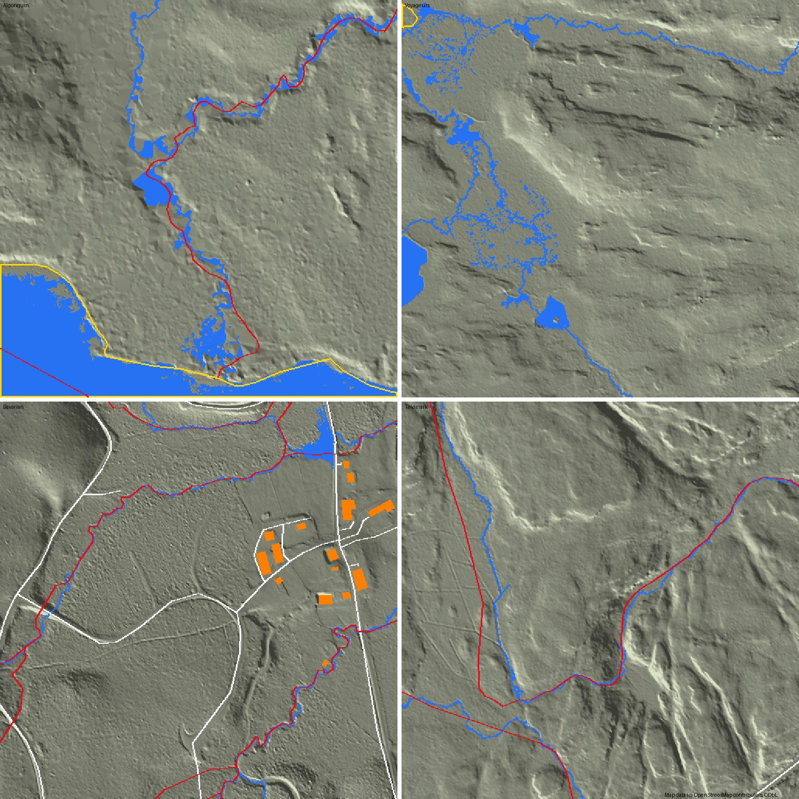
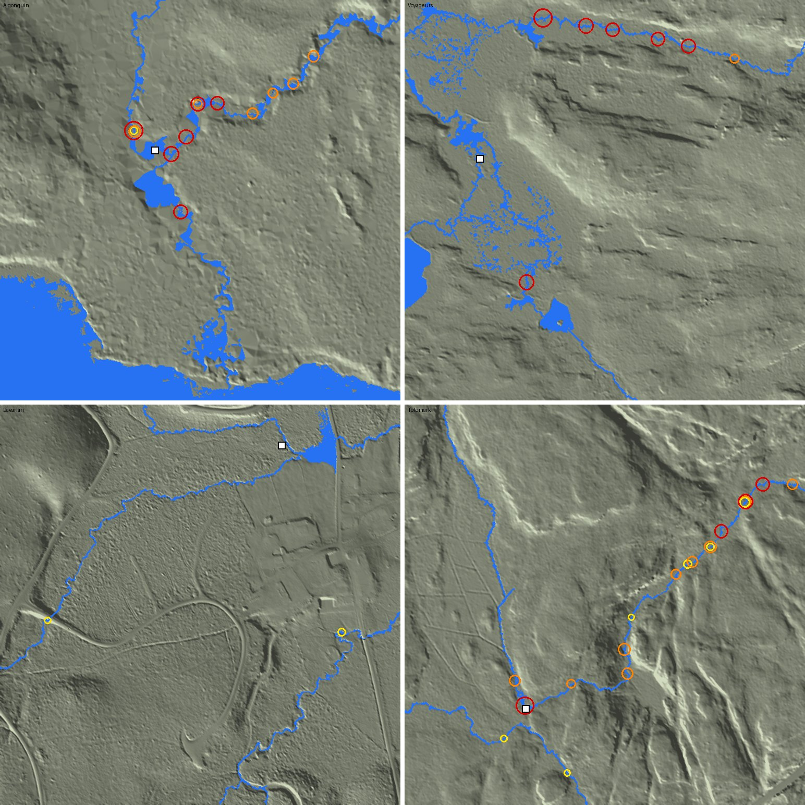
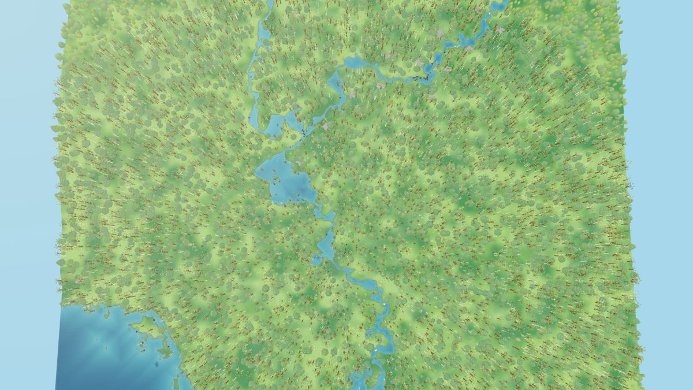
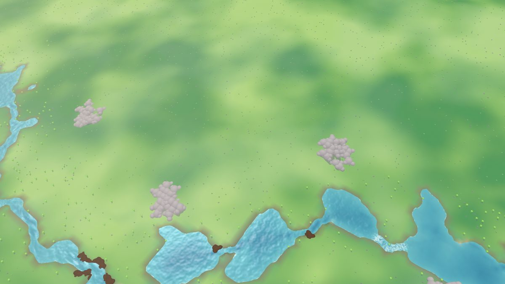
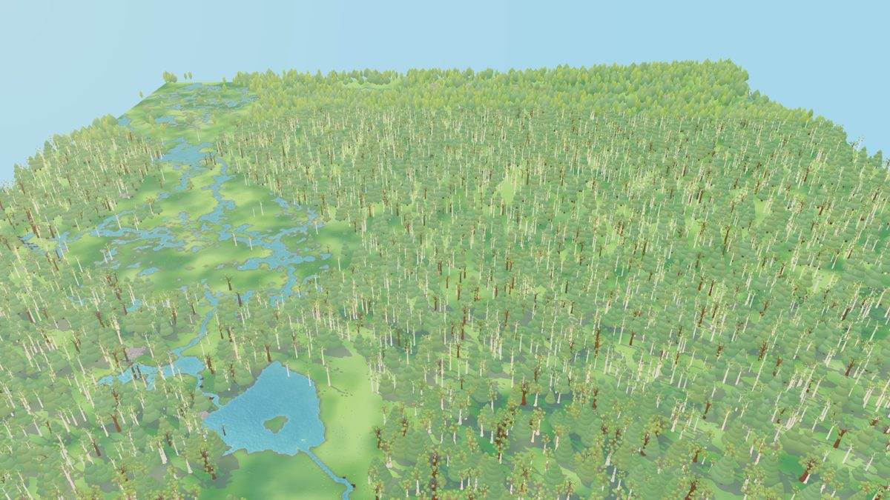
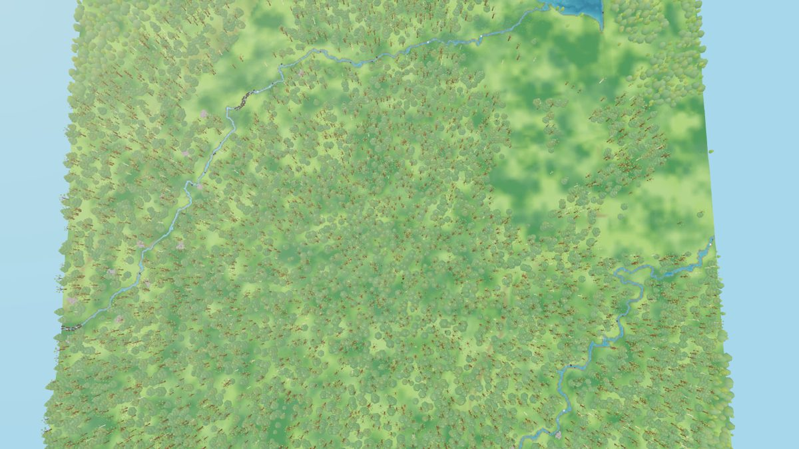
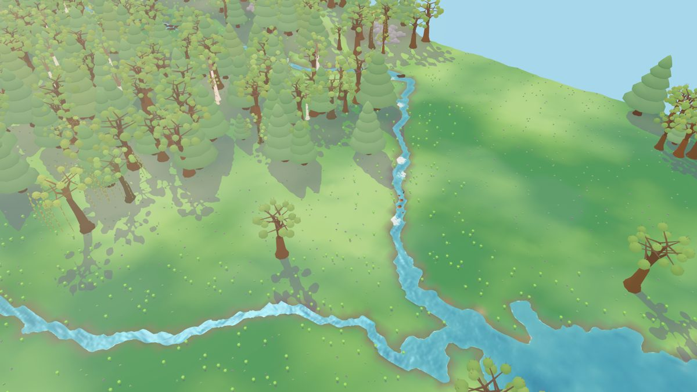
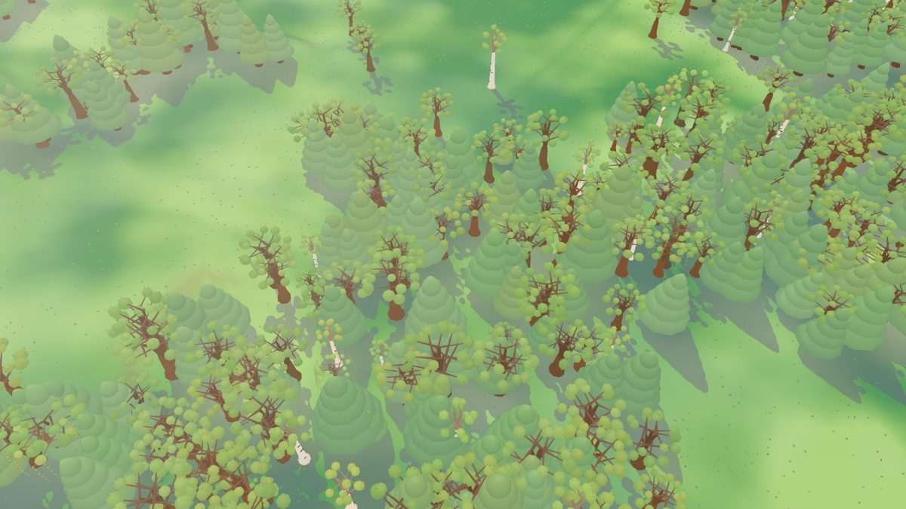
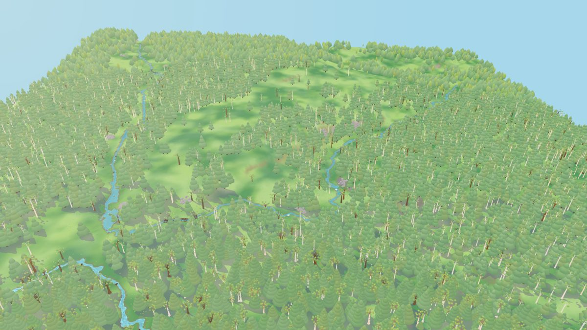
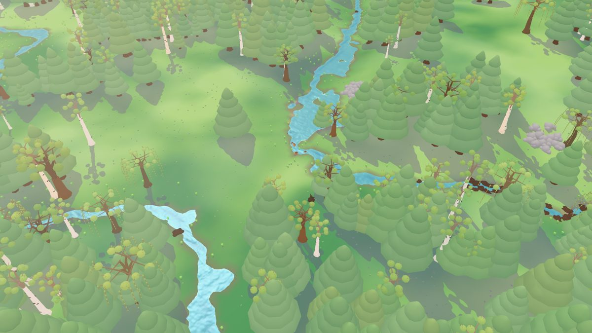

# Map audit: real places, beaver country, and dam play

Date: 2026-11-22. Code: commit `ebab563` plus the uncommitted work in the tree.

This audit checks the four maps (Algonquin, Voyageurs, Bavarian Forest, Telemark) in four ways:

1. **Is it the real place?** The game's water, terrain and forest are compared with what is actually on the ground there. The sources are OpenStreetMap, the USGS National Hydrography Dataset and satellite imagery.
2. **Is it beaver country?** The streams, the room to flood and the food are compared with what beavers need.
3. **Is it good to play?** The dam sites are measured: how many there are, how big a pond each one makes, and how far each is from the camp.
4. **Does it look right in game?** The judgement comes from fresh in-game screenshots.

Every number here was measured for this audit. *Method* at the end says how.

---

## The verdict

### How the scoring works

Nine questions, each scored 0–3, with no weighting. 3 means *yes, clearly*, 0 means *no*. The evidence for each score is in the section named in the right-hand column.

| # | Question | Algonquin | Voyageurs | Bavarian | Telemark | Evidence |
|---|---|:-:|:-:|:-:|:-:|---|
| 1 | Do the game's streams and lakes exist in reality, with nothing invented? | 2 | **0** | 1 | **3** | §1 |
| 2 | Does the map show what the place is known for? | **3** | 1 | **0** | 2 | §1 |
| 3 | Is it free of roads and buildings that the game silently leaves out? | **3** | **3** | **0** | 2 | §1 |
| 4 | Are the streams gentle enough to dam? | **3** | 1 | 1 | 2 | §2 |
| 5 | Is there low ground that a dam can turn into a pond? | **3** | 2 | **0** | 2 | §2 |
| 6 | Is the forest by the water made of beaver food trees? | 2 | **3** | **0** | 1 | §2 |
| 7 | Is there a ladder of dam sites (a cheap first dam near camp, bigger ones later)? | 2 | 1 | **0** | **3** | §3 |
| 8 | Is the camp a good home (food, a dam site, nothing odd nearby)? | **3** | 2 | **0** | 2 | §3 |
| 9 | Does the water look natural in game? | 2 | **0** | 1 | 2 | §4 |
| | **Total (out of 27)** | **23** | **13** | **3** | **19** | |

### Ranking

1. **Algonquin (23).** The real place, faithfully: a real lakeshore and a real creek in classic Shield country. The camp is excellent and big ponds are possible right beside it. It loses points because one of its two streams is invented, the creek's open meadow is drawn as forest, and the first dam can only be a 0.5 m one.
2. **Telemark (19).** The most truthful water: both streams are real and nothing is invented. It has the best dam ladder of the four (9 starter sites, the nearest 39 m from camp). Its weak points are the food (two-thirds of the bank trees are conifers) and a landscape that is typical of the region but not memorable.
3. **Voyageurs (13).** **All three streams are invented**: official US hydrography shows no stream anywhere in the window. The real site is an old beaver meadow in a forest. The game turns it into a field of puddles and leaves out the lakes and rocky shores the park is famous for. Its food trees (aspen) are the best of the four, but those come from the game's species table, not from the site.
4. **Bavarian Forest (3).** The window is a **farm hamlet**: 15 buildings, about 2 km of roads and tracks, pasture and a fence. None of it is drawn. The camp sits 52 m from the edge of the world, next to a pond that does not exist in reality. The steep creeks give almost no pond for a dam. This is neither the Bavarian Forest nor beaver country.

### The largest problems, in order

1. **Two of the four maps are the wrong piece of land.** Voyageurs has no real streams and no lakeshore. Bavarian Forest is a farmyard outside the national park. The map-picking tool scored windows by computed drainage lines and land-cover percentages. It never checked real hydrography, buildings, roads, or whether the window looks like the place it is named after.
2. **Water invented where there is none, and missing where there is some.** Examples: three phantom streams on Voyageurs, a phantom pond at the Bavarian camp, and a phantom stream on Algonquin. Meanwhile a real pond on Voyageurs stays dry.
3. **Every map has the same climate.** Four 90-day seasons, the same runoff per km², the same spring flood and the same ice, from 45.6° N to 59.5° N. The spring melt raises streams by only 1–4 cm and does not change the flooded area on any map.
4. **The beaver meadows are wrong on both maps that have one.** Algonquin's open creek meadow is planted with forest at the map-wide density. Voyageurs' meadow becomes hundreds of puddles.
5. **Food is thinnest exactly where beavers eat first.** On every map, food trees within 5 m of water are about 2–5 times sparser than 15–40 m away.

---

## 1. Is it the real place?

*Blue: the game's water at the start. Red: real streams. Yellow: real lake shores. White: real roads and tracks. Orange: real buildings. Real features are from OpenStreetMap; for Voyageurs they were also checked against the USGS National Hydrography Dataset.*

| | Algonquin | Voyageurs | Bavarian | Telemark |
|---|---|---|---|---|
| Real streams in the window | 1 (852 m) | **none** (nearest: 130–290 m outside) | 7 (1.6 km, incl. *Markbach* and *Ebenseige*) | 2 (1.1 km) |
| Game streams | 2 inflows | **3 inflows** | 4 inflows | 2 inflows |
| Game stream within 10 m / 25 m of a real stream | 58% / 74% | – (no real stream) | **88% / 97%** | 60% / 88%¹ |
| Real lakes and ponds | Whitefish Lake (3.3 ha in window) | one small pond (0.05 ha), plus a pond at the west edge seen in imagery | **none** | none |
| Game water where there is no real water | small | **3 streams, a fen of puddles** | **a pond with 750 m² deeper than 30 cm** | none |
| Real roads and buildings | none | none | **15 buildings, ~2 km roads and tracks, a fence** | a road clips the SE corner; a power line |
| Map grid vs true north | rotated 15° | 0° | 3° | 5° |

¹ The OSM stream in Telemark's north is drawn as a straight line, which is coarse mapping. In the south, where it is drawn in detail, game and real streams coincide.

### Algonquin: faithful, with three faults

- **What is right:** the window really is on the shore of **Whitefish Lake**, with a real creek running down from the north-east corner. That is classic Algonquin: lake, creek and mixed forest.
- **An invented stream:** the second inflow at the north edge (x 210) matches no mapped stream.
- **A forested meadow:** imagery shows the creek running through a wide open sedge meadow, a typical old beaver meadow. The land-cover layer at 10 m calls it forest (98% tree cover within 30 m of the streams). The game therefore plants trees along the creek at exactly the map-wide density (506 per ha).
- **Rotated by 15°:** the map uses Canada's Lambert projection, so the map's "up" is 15° off true north. That only matters if anything in the game relies on map-up being north.

### Voyageurs: the streams do not exist

- **No stream in the window:** neither the USGS National Hydrography Dataset nor OSM has one. The nearest mapped perennial streams (Clyde Creek and an unnamed one) are 130–290 m west of the map. The game's three inflows come from a drainage line computed on a coarse terrain model, not from a real stream.
- **What is really there:** imagery shows unbroken forest, a sedge meadow in the north-west quarter (an old, drained beaver pond) and a dark pond on the west boundary. A tiny pond mapped by OSM in the north-west corner is dry in game.
- **Right kind of land, wrong picture:** the Kabetogama Peninsula, where the window sits, is one of the best-studied beaver landscapes in North America. Beavers turned about 13% of it into ponds and meadows between 1927 and 1988, and dams average about 2.5 per km of stream (Naiman et al. 1988, 1994). So the land itself is genuine beaver country. But the park is known for its big lakes, and the window contains none: no Kabetogama, Namakan or Rainy Lake shoreline, no rock islands.

### Bavarian Forest: a farmyard, drawn as a meadow

- **What is there:** the hamlet on Flanitzstraße, with houses, barns, a garden plot, pasture, gravel forest roads (*Dobelweg*) and a fence. It lies outside the continuous mountain forest that the national park is known for.
- **What the game does with it:**
  - Nothing is drawn. 60 game trees stand on real building footprints, and the roads carry trees at forest density (427 per ha).
  - The farmyard reads as a lumpy meadow.
  - The terrain still holds every road bench and building pad, so water and paths follow lines the player cannot see.
- **The phantom pond:** where two real streams meet a real road embankment, the game holds a pond with 750 m² of it deeper than 30 cm. In reality a culvert carries the water under the road; OSM and land cover show no water there. **The camp is 30 m from that pond, 56 m from a real road, 86 m from real buildings and 52 m from the map edge.**
- **The streams are excellent:** 88% of the game's stream path lies within 10 m of a real stream.

### Telemark: truthful, ordinary

- Both game streams are real, and there is no phantom water.
- The window is a forested hillside with an open mire and two creeks, which is typical of inland Telemark. It does not include the region's signature lakes or deep valleys.
- A secondary road (*Vatnarvegen*) clips the SE corner. A power line crosses the map diagonally, and the game happens to thin the trees along its corridor (250 vs 476 per ha), which matches a cleared line.

---

## 2. Is it beaver country?

Beavers do best on small, gentle, permanent streams (dams rarely hold above about 15% gradient). They need low ground beside the stream that a dam can flood, and food trees close to the water: aspen, willow, birch and alder are the preferred ones.

| | Algonquin | Voyageurs | Bavarian | Telemark |
|---|---|---|---|---|
| Stream length gentler than 3% | **73%** | 86%² | 31% | 48% |
| Stream length steeper than 8% | 4% | 3% | 8% | 12% |
| Reaches where a 1 m dam up to 40 m long holds | 54 | 14 | 101 | **193** |
| Median new pond from such a dam | 1,430 m² | 1,824 m² | **146 m²** | 854 m² |
| Reaches where a 1 m dam up to 20 m long holds | 0 | 0 | 44 (median pond 113 m²) | **86** (best 2,425 m²) |
| Preferred food species within 30 m of water (aspen + willow + birch + alder) | 38% | **57%** | **17%** | 33% |
| Most common trees within 30 m of water | maple 28%, pine 16%, aspen 14% | aspen 32%, pine 23%, birch 16% | spruce 39%, beech 29%, maple 9% | pine 33%, spruce 32%, birch 18% |
| Food trees per ha: 0–5 m / 15–40 m from water | 277 / 469 | 77 / 357 | 50 / 270 | 32 / 165 |

² Measured on the game's streams, which do not exist on this map. That is why the score is 1, not 3.

- **Algonquin** is the classic case: flat, sluggish streams in a wide low valley. Its dams have to be long (no 1 m dam closes within 20 m), but they make big ponds.
- **Bavarian** has many places where a short dam holds, but the creeks are steep and the valley floors narrow. The ponds are tiny, typically 113–146 m². The bank forest is spruce and beech, with only 17% preferred food.
- **Telemark** sits in between. It is steeper and more confined, so short dams work and give medium ponds, but two-thirds of the bank trees are conifers.
- **Voyageurs** has the best bank forest, at 57% preferred food (mostly aspen). Its flat land gives big ponds, but only from long dams on streams that are not real.
- **All maps:** food trees are about 2–5 times sparser in the first 5 m from water than 15–40 m out (Algonquin 1.7×, the others 4.6–5.4×). Real beavers eat out from the bank, so the richest food should be the closest. The species mixes are set per map in the game's `tree_flora` table, not measured on site.

---

## 3. Is it good to play?

Each stream reach was tested for dams 0.5, 1.0 and 1.5 m high, built straight across the flow. A dam has to tie into higher ground on both banks within 40 m, and the pond behind it must not spill around it. Sites are sorted into three tiers:

- **Starter:** a dam of 15 m or less that floods at least 300 m² of new ground and fills within 30 days.
- **Mid:** a dam of 30 m or less that floods at least 1,000 m².
- **Big:** a dam of 80 m or less that floods at least 3,000 m².

Sites are counted at least 25 m apart.

*Yellow: starter. Orange: mid. Red: big (circle size follows the pond). White square: the camp.*

| | Algonquin | Voyageurs | Bavarian | Telemark |
|---|---|---|---|---|
| Starter sites (nearest to camp) | 1 (37 m) | **0** | 2 (251 m) | **9 (39 m)** |
| Best starter | 15 m dam, 0.5 m high → 485 m² | – | 7 m dam, 0.5 m high → 464 m² | **10 m dam, 1 m high → 2,348 m²** |
| Mid sites (nearest) | 6 (35 m) | 1 (**350 m**) | **0** | 9 (39 m) |
| Big sites (nearest) | 6 (22 m) | 6 (169 m) | **0** | 4 (4 m) |
| Best big site | 50 m dam, 1.5 m → 6,877 m² | 67 m dam, 1.5 m → 6,947 m² | – | 67 m dam, 1.5 m → 6,400 m² |
| Food trees / food plants within 50 m of camp | **247 / 497** | 132 / 558 | 65 / 439 | 83 / 186 |
| Camp distance to the map edge | 192 m | 96 m | **52 m** | 123 m |

- **Telemark** has the best progression. A cheap, effective first dam is 39 m from home, there are nine more of each size to grow into, and a big valley-floor dam is possible right at the camp. Food is its constraint, which makes for a good "hard" map.
- **Algonquin** has its big ponds right beside the camp and the richest camp of all, but no proper starter. The only short dam is 0.5 m high, so the first real dam is already a 23–30 m project.
- **Voyageurs** has nothing to build early. The nearest mid site is 350 m from the camp, and the big sites need long dams (45–67 m for the best three), the nearest 169 m away.
- **Bavarian** offers two tiny starter dams 250–375 m from the camp and nothing beyond them. The camp itself sits on a pasture at the edge of the world, beside the phantom pond.

---

## 4. Does it look right in game?

| | Separate water bodies (> 2 cm): start / day 45 / summer / winter | What the eye sees |
|---|---|---|
| Algonquin | 26 / 6 / 22 / 20 | A lake and a beaded chain of ponds. The ponds have some hard, angular corners, and the lake runs off the map's south and west edges into sky |
| Voyageurs | **314** / 51 / 133 / 114 | A field of puddles where the real site is a meadow |
| Bavarian | 14 / 3 / 51 / 26 | Good meandering creeks; a straight-sided phantom pond against an invisible road |
| Telemark | 53 / 9 / 111 / 71 | Clean creeks and a readable confluence; in summer the creeks break into beads |

*Algonquin: the lake and the pond chain read well. An even carpet of trees covers what is, in reality, an open meadow along the creek.*

*Algonquin's creek with the trees hidden: a beaver-pond chain, joined by short spillways.*

*Voyageurs: the puddle field. The real site is an unbroken forest with a sedge meadow, and no stream.*

*Bavarian Forest: the open patch on the right is the farmyard, with its 15 buildings and roads left out. The phantom pond is top right.*

*The Bavarian camp: a pasture between two creeks, the phantom pond, and the end of the world 52 m away.*

*Where the real farm buildings stand: open meadow with scattered trees.*

*Telemark: the open mire, the conifer slopes and the creek confluence by the camp read as a plausible Nordic valley.*

---

## 5. Problems every map shares

### One climate from Ontario to Norway

The water and calendar code has no per-map setting. Every map gets:

- four seasons of exactly 90 days;
- the same seasonal inflow curve (×3 in spring, ×0.3 in summer, ×0.8 in autumn, ×0.1 in winter);
- the same ice growth;
- the same runoff of 0.01 m³/s per km² (about 315 mm a year);
- the same wolf.

| What differs in reality | What the game does |
|---|---|
| Winter at 59.5° N (Telemark) is much longer than at 45.6° N (Algonquin) | Identical 90-day winters |
| Northern Minnesota is dry: gauged rivers near Voyageurs run roughly 5–9 inches (120–230 mm) a year (USGS) | 315 mm a year, so Voyageurs' streams carry roughly 1.4–2.5 times too much water |
| Mountain Bavaria and southern Norway are much wetter than Minnesota | The same runoff as Minnesota |
| Snowmelt is the biggest flow of the year on these streams, and it floods meadows | The spring peak raises stream depth by only 1–4 cm (median 9→13 cm Algonquin, 6→7 cm Voyageurs, 6→8 cm Bavarian, 5→6 cm Telemark). Flooded area does not change: Algonquin 14.07% → 14.07%, Telemark 0.68% → 0.73% |

The maps feel alike over a year because, apart from the terrain, they are alike.

### Map windows chosen without looking

`tools/hires_maps.py` picks windows by scoring:

- drainage lines computed on a 4 m terrain model, with a 0.2 km² minimum catchment;
- stream gradient;
- how many of those lines cross the edge;
- floor area;
- land-cover percentages (≤ 3% "farmed" class).

It never consults real hydrography, building or road data, imagery, or the region's signature features. That is how Voyageurs got streams that do not exist and Bavarian Forest got a farmyard. A computed drainage line of 0.3 km² is not necessarily a stream in reality.

### Small and square

Every map is 512 × 512 m. That is enough for one or two beaver territories, but too small to hold a region's defining features unless the window is chosen for them. Water that reaches the boundary ends in sky: Algonquin's lake on two sides, the Voyageurs pond, and the Bavarian camp's surroundings.

---

## 6. What to do with each map

| Map | Recommendation |
|---|---|
| **Algonquin** | **Keep.** Draw the creek's meadow as open sedge meadow, not forest. Remove the invented north inflow, or confirm it from Ontario's hydro network. Give the player one short, ≥ 1 m starter site near camp. Frame the lake so it does not run off two edges. |
| **Telemark** | **Keep.** Raise the share of birch, willow and alder by the water so food is not the only story. Optionally move the window to include a lake or valley floor that says "Telemark". |
| **Voyageurs** | **Replace the window.** Put it on a Kabetogama or Namakan shoreline, where an inlet creek enters a bay through beaver meadows. That gives the lake, rock and islands the park is known for, plus real streams to dam. If this window stays, remove the three invented streams and draw the meadow as meadow. |
| **Bavarian Forest** | **Replace the window.** Choose a stream inside the national park's continuous forest, with no buildings and no roads in the window. Bavarian streams with beavers are not hard to find there. |
| All maps | **Climate per map:** season lengths, runoff, spring-flood size and timing, and ice. **Picking windows:** require real mapped streams (OSM, NHD, national hydro networks), reject buildings and roads, check against imagery, and score the region's signature features. **Food:** put the richest beaver food at the water's edge. |

---

## Method

- **Game state:** the sandbox runner (`cargo run --release -p sim --example sandbox`) dumped every map at the start of a new game, after 45 days, after 40 days of summer and after 30 days of winter. Camp, dam plan, trees, food plants and the cells where the family may settle at start came from `starts::new_game_on_map`, through a throwaway example that was deleted after use.
- **Reality:** OpenStreetMap data came from the OSM API for each window plus a margin, and was projected into each map's grid with the projection and origin the map builder used (`tools/hires_window.py`). USGS NHD flowlines and waterbodies were queried for Voyageurs. Esri World Imagery was viewed for every window and saved nowhere. Background facts come from Naiman, Johnston & Kelley (1988, *BioScience*) and Naiman, Pinay, Johnston & Pastor (1994, *Ecology*) for the Kabetogama Peninsula, and from USGS Minnesota annual water reports for Rainy River runoff.
- **Stream slope** is the gradient of the 4 m-smoothed water surface along the game's stream cells. **Dam sites:**
  - Each stream reach's direction was taken from the stream cells around it, and a straight dam was laid across that direction.
  - The pond is the region below the crest that connects upstream, and it must not connect around the dam.
  - "New" pond area excludes ground that is already wet.
  - Fill time is the pond volume divided by the largest discharge within 3 m of the dam.
- **Food:** trees and food plants are the game's own resources at the start. "Preferred food species" means aspen, willow, birch and alder.
- **Screenshots:** `tools/game_shot.sh` on the release build of the current tree, at day 0.
- All scripts, dumps and raw downloads stayed in a temporary folder outside the repository.
