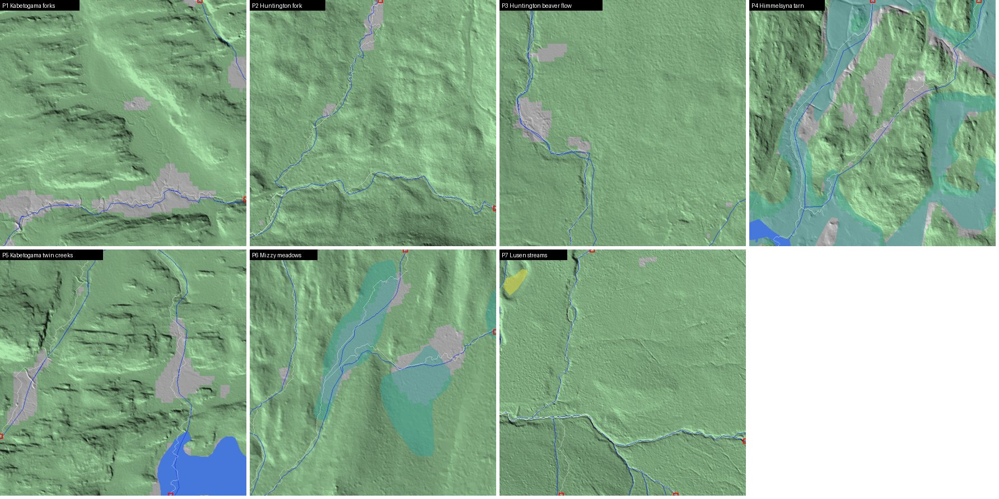
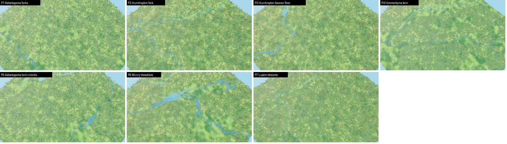
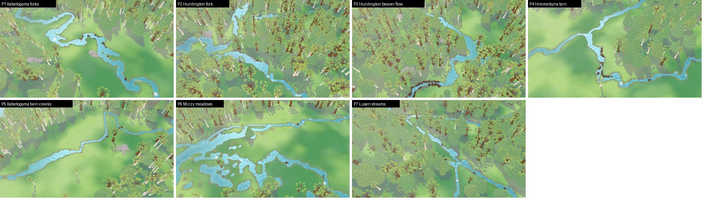
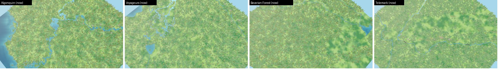

# Map proposals: better 512 m windows from real beaver country

Date: 2026-11-22. This builds on [map_audit.md](map_audit.md) and adds your three new rules:
- a gentle slope on each side of the streams;
- several real inflows, and ideally more than one outflow;
- little open water at the start.

## Summary

I searched 12 regions known for beavers for 512 m × 512 m windows. About 118,000 windows passed the hard filters. I built 17 of them as 1 m game maps. On each one I ran the game's water engine for a year, under the game's climate and under the place's own weather. I then screenshotted it in the game, and checked it against lidar detail and satellite imagery for roads that the maps leave out.

Seven proposals are worth considering. All seven have:
- streams that follow real mapped streams (95–100% within 25 m);
- at least two real inflows;
- no road, track, building, ditch or power line in OpenStreetMap;
- 0.5–2.7% open water at the start.

| | Proposal | Place | Score /36 | In one line |
|---|---|---|:-:|---|
| **P1** | Kabetogama forks | Voyageurs NP, Minnesota | **31** | A real creek in an open meadow, with gentle valley sides and almost no puddles. The creek runs along the south of the map. Replaces today's Voyageurs (16). |
| **P2** | Huntington fork | Adirondacks, New York | **28** | The best-shaped valley of all: a Y of two creeks with dams of every size near camp. It has an unmapped logging road that would have to be smoothed out. |
| **P3** | Huntington beaver flow | Adirondacks, New York | **27** | A real chain of beaver ponds and meadows, with nothing man-made. The stream runs near the west edge. |
| **P4** | Himmelsyna tarn | Agder, Norway | **26** | Bedrock ridges, mires and a tarn, 2 km from a 2020 record of an occupied lodge and a fresh dam. The alternative to Telemark (23). |
| **P5** | Kabetogama twin creeks | Voyageurs NP, Minnesota | **27** | Visible beaver ponds and meadows on glacier-scoured ridges, and the most dam sites near camp. Some puddles, and the camp is 54 m from the edge. |
| **P6** | Mizzy meadows | Algonquin, Ontario | **24** | Two open beaver meadows, 3 inflows and 4 outflows, no lake. Small ponds and flat lidar triangles in the meadows. Does not beat today's Algonquin (27). |
| **P7** | Lusen streams | Bavarian Forest NP | **22** | Four inflows inside the national park, with no roads. The streams are steep (3.7%), so dams make only small ponds. Replaces today's Bavarian Forest (12). |

**Recommended line-up:**

| Slot | Do | Why |
|---|---|---|
| Algonquin | **Keep today's map**, with the audit's fixes | It still scores 27. It loses points only for its lake (14% open water at start) and its flat valley sides. P6 is the lake-free alternative, if you want one. |
| Voyageurs | **Replace with P1 or P5** | P1 scores 31 against 16, but its creek runs along the south of the map. P5 (27) has two creeks crossing the whole map and the most dam sites, at the cost of some puddles and a camp near the edge. |
| Telemark | **Replace with P4**, or keep Telemark | 26 against 23. P4 is in Agder, next to Telemark and part of the same historic beaver stronghold. |
| Bavarian Forest | **Replace with P7**, or drop the slot for **P3** | No window in or near the park is both road-free and gentle. P7 is the best road-free one (22). P3 (27) is the better beaver map. |

Every documented beaver territory I checked in the Bavarian Forest park (six sites) has a forest track or an old log-driving dam within 512 m. These are the park's own beaver-monitoring sites, so this is a real limit of the place, not of the search.

Section 5 sets out the weather data for every map. It uses 30 years of daily weather and, where one exists, the region's stream gauge, saved in the map file header. All seven proposal files already carry it and load in the game today.

---

## 1. How the search worked

**Regions.** These are documented beaver areas where 1 m lidar is free to use:

| Region | Lidar | Beaver evidence used |
|---|---|---|
| Voyageurs NP, west and north Kabetogama Peninsula | USGS 3DEP | Naiman's study area, with 2.5 dams/km and up to 3 colonies/km² ([Naiman et al. 1988](https://www.dfw.state.or.us/agency/commission/binders/19/06_Jun/Beaver%20Petition%20Bibliography/Naiman%20et%20al_1988.pdf)). Pond maps cover 1940–2005 ([Johnston & Windels 2015](https://www.hydroshare.org/resource/20f1b8be86d74d198848a6d254556a40/)). NPS beaver-pond trails ([NPS](https://www.nps.gov/voya/planyourvisit/hike-to-health-gps-locations.htm)). |
| Algonquin, around the Wildlife Research Station and Mizzy Lake | NRCan HRDEM | The station's beaver studies since the 1950s ([WRS](https://www.algonquinwrs.ca/index.php/mammalogy/)). Mizzy Lake Trail, with nine beaver ponds ([Ontario Parks](https://algonquinpark.on.ca/visit/recreational_activites/mizzy-lake-trail.php)). |
| Bavarian Forest NP, Lusen and Rachel sides | Bayern DGM1 | 27 active territories in 2024 ([park monitoring report 2024](https://nationalpark-bayerischer-wald.bayern.de/service/downloads/doc/berichte/bericht_bibermonitoring_2024.pdf)). |
| Upper Palatinate Forest (Bavaria) | Bayern DGM1 | Dams and lodges reported on a forest stream. |
| Agder and Telemark (Seljord, Kragerø), Norway | Kartverket NHM | Dated dam and lodge records ([GBIF / Artsobservasjoner](https://www.gbif.org/occurrence/2985010339)) in the beaver's historic Norwegian stronghold ([Rosell & Parker](https://pmc.ncbi.nlm.nih.gov/articles/PMC4630256)). |
| Adirondacks, Huntington Wildlife Forest | USGS 3DEP | Colonies monitored for 30+ years, about 20 active ([Adirondack Life](https://www.adirondacklife.com/2018/10/25/bark-eaters)). Beaver meadows on Panther Brook ([Keck 2017](https://keckgeology.org/wp-content/uploads/2017/Keck%20PDFs%202017/JUNGERS.pdf)). |
| Rocky Mountain NP, Kawuneeche Valley | USGS 3DEP | Historic beaver meadows; beavers absent now ([Mertz 2025](https://mountainscholar.org/bitstreams/c946f2eb-d3a5-4ae6-ad8d-59de43d94483/download)). |

**Scan (4 m grid, every 32 m).** Each region was 8–12 km across. Every 512 m window got these checks:
- **Hard filters**, which reject the window:
  - any road, building, power line or railway in OpenStreetMap;
  - more than 3% farmland or built-up land;
  - more than 15% open water.
- **Penalties:**
  - forest tracks (heavy), paths, ditches and dams;
  - edge-hugging streams;
  - open water at the start.
- **Real streams:** OpenStreetMap streams, plus the USGS National Hydrography Dataset for the US regions.
  - An **inflow** is a real stream that enters the window and runs at least 100 m inside it.
  - An **outflow** is a real stream that leaves the window.
- **Valley sides:** every 8 m along each real stream, the ground was sampled at 8, 20, 50 and 120 m on both sides.
  - **Gentle:** the ground rises at least 1 m within 120 m, but not more than 8 m within 20 m or 14 m within 50 m.
  - **Flat:** less than 1 m of rise within 120 m. The water then spreads into puddles.
  - **Steep:** anything above the gentle limits.
- **Also scored:** stream gradient, ground less than 1.5 m above a stream (room to flood), and tree cover.

**Build (1 m).** The best windows were rebuilt from the same 1 m lidar as today's maps. Each inflow sits where a real stream crosses the edge, and its catchment comes from the region's drainage. The weather block (section 5) goes into the header.

**Test.** Every built map went through the same measurements as the audit:
- dam sites at 0.5, 1 and 1.5 m;
- food by the water and at the camp;
- the game's own camp choice;
- water bodies over a year in the sandbox;
- two extra runs with the place's own spring-peak and late-summer flows.

Then each map got:
- an in-game screenshot;
- a lidar detail render;
- a satellite check for roads, clearings and ponds that OpenStreetMap misses.

---

## 2. Scores

The audit's nine questions, plus your three new ones, each scored 0–3. For the current maps, questions 1–3 are the audit's judgement scores. Questions 4–12 are measured with one rule set for all eleven maps, so today's maps score slightly differently from the audit. The rules are listed under the table.

| | Algonquin | Voyageurs | Bavarian | Telemark | **P1** | **P2** | **P3** | **P4** | **P5** | **P6** | **P7** |
|---|:-:|:-:|:-:|:-:|:-:|:-:|:-:|:-:|:-:|:-:|:-:|
| 1. Real water, nothing invented | 2 | 0 | 1 | 3 | 3 | 3 | 2 | 2 | 2 | 2 | 3 |
| 2. Shows what the place is known for | 3 | 1 | 0 | 2 | 2 | 2 | 3 | 3 | 3 | 3 | 2 |
| 3. No hidden roads or buildings | 3 | 3 | 0 | 2 | 3 | 1 | 3 | 2 | 3 | 3 | 2 |
| 4. Streams gentle enough to dam | 3 | 3 | 1 | 2 | 3 | 2 | 3 | 2 | 3 | 2 | 0 |
| 5. Low ground a dam can flood | 3 | 3 | 0 | 2 | 3 | 2 | 2 | 2 | 2 | 1 | 0 |
| 6. Food trees at the water's edge | 3 | 1 | 0 | 0 | 0 | 2 | 2 | 0 | 1 | 2 | 0 |
| 7. Dam ladder near camp | 3 | 0 | 0 | 3 | 3 | 3 | 2 | 3 | 3 | 2 | 1 |
| 8. Camp is a good home | 3 | 2 | 0 | 2 | 3 | 3 | 2 | 2 | 2 | 2 | 3 |
| 9. Water looks natural in game | 2 | 0 | 3 | 1 | 3 | 3 | 2 | 3 | 2 | 1 | 3 |
| 10. **Gentle slope on both sides of the streams** *(new)* | 1 | 1 | 1 | 1 | 3 | 3 | 2 | 2 | 2 | 1 | 2 |
| 11. **Several real inflows and outflows** *(new)* | 1 | 0 | 3 | 2 | 2 | 2 | 1 | 2 | 2 | 3 | 3 |
| 12. **Little open water at the start** *(new)* | 0 | 2 | 3 | 3 | 3 | 2 | 3 | 3 | 2 | 2 | 3 |
| **Total (out of 36)** | **27** | **16** | **12** | **23** | **31** | **28** | **27** | **26** | **27** | **24** | **22** |

<details><summary>Scoring rules</summary>

1. 3 if at least 95% of game stream lies within 25 m of a real stream and the map starts with 15 or fewer water bodies. 2 if 90% or more.
   - Proposals P3, P5 and P6 lose a point for puddles at the start.
   - P4 loses a point because a real tarn is missing (see P4).
2. Judgement, based on the beaver evidence for each place (section 3).
3. Judgement, based on OpenStreetMap, the lidar detail render and satellite imagery.
4. Stream length under 3% gradient: 3 for at least 85%, 2 for 70–85%, 1 for 50–70%, otherwise 0.
5. Median new pond from a 1 m dam (up to 40 m to each bank): 3 for at least 1,500 m², 2 for 700–1,500 m², 1 for 300–700 m², otherwise 0.
6. Food trees per ha within 5 m of water: 3 for at least 200, 2 for 100–200, 1 for 50–100, otherwise 0.
7. One point for each dam tier (starter, mid, big) with a site within 150 m of the camp.
8. Starts at 3. One point off each for:
   - fewer than 100 food trees within 50 m;
   - camp closer than 80 m to the edge;
   - no starter dam within 150 m.
   - No founding site at all scores 0.
9. Water bodies at the start: 3 for 15 or fewer, 2 for up to 50, 1 for up to 150, otherwise 0.
10. Stream length with a gentle slope on both sides: 3 for at least 75%, 2 for 60–75%, 1 for 45–60%, otherwise 0.
11. Real inflows and places where water leaves the map:
    - 3 for at least 3 inflows and at least 2 exits;
    - 2 for at least 2 of each;
    - 1 if only one of those holds.
12. Map area under more than 5 cm of water at the start: 3 for 1% or less, 2 for up to 3%, 1 for up to 8%, otherwise 0.
</details>

---

## 3. The proposals



*Above: the seven windows, each 512 m across. Real streams are from OpenStreetMap and USGS. The white dots are where the game routes each stream.*







### P1 Kabetogama forks: Voyageurs NP (48.4748 N, 92.9360 W)

- **What it is:**
  - A creek with a 6.4 km² catchment crosses the south of the map in an open meadow between bedrock ridges.
  - A second creek (4.4 km²) cuts across the north-east corner.
  - Water leaves the map in three places.
  - It lies inside the area of the Kabetogama Peninsula beaver-pond record (1940–2005).
- **Strengths:**
  - The best valleys of all eleven maps: 92% of the stream has a gentle slope on both sides, and only 7% is flat on a side.
  - Big ponds: a 1 m dam floods a median of 2,274 m² of new ground.
  - Clean water: 3 water bodies at the start, against 314 on today's Voyageurs map.
  - Dams of every size within 90 m of camp.
- **Weaknesses:**
  - Food is thin right at the water (27 food trees/ha within 5 m). That is the game's placement problem from the audit.
  - Only 653 m of stream. Three-quarters of the map is ridge forest away from water, and the camp is 87 m from the south edge.
  - It is the interior of the park, not the lakeshore it is famous for. You asked for less open water, so the lakeshore windows were set aside.
- **Fix:** None simple. Shifting the window south centres the creek, but in the scan it then loses the north-east creek and has only one inflow.

### P2 Huntington fork: Adirondacks (44.0359 N, 74.2337 W)

- **What it is:** A Y-junction of two creeks (1.3 and 7.2 km²) in mixed hardwood forest, with two outflows.
- **Strengths:**
  - Valley sides gentle on 87% of the stream.
  - All three dam tiers within 60 m of camp.
  - 267 food trees within 50 m of camp.
  - 7 water bodies at the start.
- **Weakness:** The lidar shows an **unmapped forest road** that OpenStreetMap does not have. It is a raised bed about 700 m long. It enters at the west edge beside the creek, crosses the map to the north-east, and runs north along the east side.
- **Fix:** Smooth the road bed out of the heights before shipping. Without that it scores 1 on question 3.

### P3 Huntington beaver flow: Adirondacks (44.0472 N, 74.2855 W)

- **What it is:** Two small creeks (0.2 km² each) join and run south through a chain of beaver meadows and ponds. The ponds are clearly visible in satellite imagery. The forest has 559 trees/ha.
- **Strengths:**
  - Nothing man-made in OpenStreetMap, the lidar or the imagery.
  - It looks exactly like what it is.
  - The camp is 168 m from the edge.
- **Weaknesses:**
  - The stream runs in the western third of the map, so the east two-thirds is dry forest.
  - Only one outflow.
  - 28 small water bodies at the start, from the old meadow hollows.
- **Fix:** Shift the window about 150 m west to centre the meadows, then check again for roads.

### P4 Himmelsyna tarn: Agder, Norway (58.6304 N, 7.9919 E)

- **What it is:**
  - Rugged bedrock ridges with mire valleys between them.
  - Two streams (0.2 and 0.6 km²) join and leave the map in two places.
  - It is 2.2 km west of a [2020 record](https://www.gbif.org/occurrence/2985010339) of an occupied lodge, a large winter food store and a fresh dam.
  - I first built the window 100 m further east (Himmelsyna), but its camp was 40 m from the edge; this one moved 100 m west.
- **Strengths:**
  - Four mid-size dam sites, the nearest 45 m from camp.
  - Little open water at the start.
  - It looks like Scandinavian beaver country, not like a copy of the Canadian maps.
- **Weaknesses:**
  - A long, narrow **tarn** visible in satellite imagery is missing in game. Land cover at 10 m misses it, and the game draws a stream through it. It is probably a beaver pond, so a player could rebuild it, but it is a real pond left dry.
  - There is a small cleared field in the north-west corner.
  - The Norwegian species mix gives only 35% food trees by the water, the same as Telemark.
- **Fix:** Take ponds and lakes from OpenStreetMap water polygons as well as land cover.

### P5 Kabetogama twin creeks: Voyageurs NP (48.5452 N, 92.9617 W)

- **What it is:** Two creeks (0.3 km² each) run through meadows and small beaver ponds between parallel glacier-scoured ridges, and leave the map in three places. It is 2.6 km east of Locator Lake, which has an NPS beaver-pond trail.
- **Strengths:**
  - The richest dam ladder near camp: 6 mid-size sites, the nearest 29 m away.
  - It is the classic Kabetogama beaver look.
- **Weaknesses:**
  - 31 water bodies at the start.
  - The camp is 54 m from the edge.
- **Fix:** None needed; P1 is cleaner.

### P6 Mizzy meadows: Algonquin (45.5368 N, 78.6681 W)

- **What it is:** Two large open beaver meadows on creeks (0.3, 0.5 and 1.4 km²), with 3 inflows and 4 outflows. It is 2 km east of the Mizzy Lake Trail.
- **Strengths:**
  - The best inflow and outflow pattern of all maps.
  - No lake at the start.
  - The meadows match the satellite image.
- **Weaknesses:**
  - The meadows had no lidar ground returns, so the terrain there is **flat triangles**. Water settles into them as small straight-edged pools: 67 water bodies at the start.
  - Ponds are small, with a median of 497 m² from a 1 m dam.
- **Verdict:** An alternative only if you want Algonquin without its lake. Today's map scores higher.

### P7 Lusen streams: Bavarian Forest NP (48.9435 N, 13.4294 E)

- **What it is:** Four small streams (0.05–1.1 km²) in spruce and beech forest inside the national park, with no roads, tracks or buildings.
- **Strengths:**
  - The only road-free Bavarian window with several inflows.
  - Clean water: 11 water bodies at the start.
  - The camp is 108 m from the edge.
- **Weaknesses:**
  - Steep: 3.7% median gradient, and only 40% of the stream is under 3%.
  - Dams make small ponds (median 154 m²), and there is no mid or big dam site.
  - Two straight channels in the lidar look like the park's old log-driving canals.
  - No beaver territory is recorded inside this window. The nearest documented one (Martinsklause) is 3.4 km east.
- **Verdict:** Much better than today's farm hamlet (12). It is still the weakest beaver map of the seven.

---

## 4. Comparison on the audit's measurements

All numbers come from the same scripts, run on the four current maps and the seven proposals. Here "mapped real streams" means OpenStreetMap, plus the USGS National Hydrography Dataset in the US. The current maps' real-place figures are the audit's.

| | Algonquin | Voyageurs | Bavarian | Telemark | **P1** | **P2** | **P3** | **P4** | **P5** | **P6** | **P7** |
|---|:-:|:-:|:-:|:-:|:-:|:-:|:-:|:-:|:-:|:-:|:-:|
| *Real place* | | | | | | | | | | | |
| Game streams within 25 m of a mapped real stream | 74% | 0% | 97% | all | 100% | 100% | 100% | 99% | 97% | 95% | 100% |
| Real inflows / places water leaves the map | 1 / 2 | 0 / 5 | 4 / 5 | 2 / 3 | 2 / 3 | 2 / 2 | 2 / 1 | 2 / 2 | 2 / 3 | 3 / 4 | 4 / 2 |
| Roads, tracks, buildings, ditches (OSM) | none | none | 15 buildings, ~2 km roads | 1 road, 1 power line | none | none | none | none | none | none | none |
| Open water at start (% of map deeper than 5 cm) | 13.91% | 2.32% | 0.96% | 0.35% | 0.68% | 1.18% | 0.9% | 0.8% | 1.15% | 2.69% | 0.47% |
| *Beaver country* | | | | | | | | | | | |
| Stream length under 3% gradient | 91% | 92% | 59% | 73% | 87% | 77% | 90% | 78% | 87% | 77% | 40% |
| Median stream gradient | 1.0% | 0.5% | 2.7% | 1.6% | 1.1% | 1.4% | 0.8% | 1.3% | 0.9% | 1.1% | 3.7% |
| Stream length with a gentle slope on both sides | 51% | 59% | 54% | 50% | 92% | 87% | 65% | 64% | 64% | 53% | 72% |
| … flat on a side (no rise of 1 m within 120 m) | 49% | 41% | 46% | 38% | 7% | 13% | 35% | 34% | 28% | 47% | 28% |
| Reaches where a 1 m dam holds / median new pond | 92 / 1,646 m² | 98 / 1,924 m² | 145 / 179 m² | 239 / 981 m² | 35 / 2,274 m² | 216 / 740 m² | 100 / 1,011 m² | 279 / 1,183 m² | 132 / 936 m² | 191 / 497 m² | 360 / 154 m² |
| Food trees per ha, 0–5 m from water | 276 | 76 | 49 | 31 | 27 | 143 | 112 | 16 | 88 | 137 | 43 |
| Food trees per ha, 15–40 m from water | 468 | 357 | 269 | 164 | 334 | 443 | 428 | 130 | 332 | 367 | 319 |
| Trees within 30 m of water that beavers eat | 77% | 66% | 58% | 35% | 67% | 75% | 76% | 35% | 68% | 76% | 55% |
| *Play* | | | | | | | | | | | |
| Starter dams (≤15 m long, ≥300 m² new pond, fills ≤30 d): count, nearest to camp | 1, 36 m | 0 | 2, 251 m | 8, 38 m | 2, 90 m | 3, 58 m | 2, 184 m | 2, 45 m | 1, 29 m | 1, 203 m | 5, 67 m |
| Mid dams (≤30 m, ≥1,000 m²) | 3, 35 m | 1, 350 m | 0 | 5, 38 m | 3, 55 m | 2, 54 m | 2, 24 m | 4, 45 m | 6, 29 m | 2, 132 m | 0 |
| Big dams (≤80 m, ≥3,000 m²) | 3, 36 m | 3, 169 m | 0 | 2, 4 m | 2, 84 m | 3, 33 m | 2, 24 m | 2, 145 m | 4, 81 m | 3, 50 m | 0 |
| Food trees / food plants within 50 m of camp | 247 / 497 | 132 / 558 | 65 / 439 | 83 / 186 | 138 / 262 | 267 / 289 | 248 / 194 | 37 / 311 | 148 / 351 | 103 / 371 | 169 / 468 |
| Camp distance to map edge | 192 m | 96 m | 52 m | 122 m | 87 m | 84 m | 168 m | 83 m | 54 m | 208 m | 108 m |
| *Looks (game climate)* | | | | | | | | | | | |
| Water bodies: start / day 45 / summer / winter | 26 / 6 / 22 / 20 | 314 / 51 / 133 / 114 | 14 / 3 / 51 / 26 | 53 / 9 / 111 / 71 | 3 / 2 / 2 / 2 | 7 / 4 / 9 / 3 | 28 / 7 / 35 / 30 | 7 / 2 / 38 / 21 | 31 / 6 / 53 / 37 | 67 / 10 / 79 / 52 | 11 / 7 / 18 / 17 |
| *Own weather (section 5)* | | | | | | | | | | | |
| Open water at own spring peak / own late-summer low | 13.96% / 13.46% | 2.29% / 1.73% | 1.16% / 1.02% | 0.48% / 0.28% | 0.68% / 0.58% | 1.35% / 1.12% | 1.03% / 0.77% | 0.98% / 0.78% | 1.2% / 0.95% | 3.15% / 2.18% | 0.56% / 0.5% |
| Stream length still flowing at own late-summer low | 89% | 74% | 99% | 87% | 95% | 94% | 80% | 86% | 73% | 84% | 99% |

How to read the table:
- **Valley sides.** All four current maps are flat on at least one side along 38–49% of their streams. P1 and P2 are flat on 7% and 13%.
- **Open water at the start.** Today's Algonquin starts with 14% of the map under water (Whitefish Lake). All proposals start with 0.5–2.7%.
- **Puddles.** Today's Voyageurs starts with 314 separate water bodies; P1 starts with 3.
- **Food at the edge.** The thin food at the water's edge remains on every map, current or proposed. It comes from how the game places trees, not from the place.

---

## 5. Weather saved with the map

### Why

Every map has the same climate today:
- one runoff of 0.01 m³/s per km², about 330 mm a year;
- the same season multipliers (spring 3.0, summer 0.3, autumn 0.8, winter 0.1);
- the same rain, evaporation and ice.

The real places differ in timing as well as amount.

### The real weather of each place

Sources:
- Monthly temperature, precipitation, snow and reference evaporation: daily ERA5 reanalysis for 1991–2020 ([Open-Meteo archive](https://open-meteo.com/en/docs/historical-weather-api)).
- Monthly runoff shape: a daily snow-and-soil water balance.
- Runoff total: scaled to the nearest stream gauge where one exists ([USGS 05131448](https://waterdata.usgs.gov/monitoring-location/05131448/), [05129115](https://waterdata.usgs.gov/monitoring-location/05129115/), [01312000](https://waterdata.usgs.gov/monitoring-location/01312000/), [ECCC 02KD006](https://wateroffice.ec.gc.ca/report/historical_e.html?stn=02KD006), [02EB014](https://wateroffice.ec.gc.ca/report/historical_e.html?stn=02EB014), [Große Ohe, Klöcking & Beudert 2006](https://www.umweltbundesamt.de/system/files/medien/370/dokumente/kloecking_beudert_at_synap2006.pdf)).
- Ice: ice forms when the 20-day mean air temperature falls below −1.5 °C and goes when it rises above +2 °C. This matches the recorded ice dates on Kabetogama Lake (28 Nov / 28 Apr, [NPS](https://www.nps.gov/voya/planyourvisit/seasonal-weather.htm)) and Lake of Two Rivers (11 Dec / 25 Apr, [Algonquin Park](https://www.algonquinpark.on.ca/news/ice-out.php)) within a week.

Checks on the water balance:
- Where a gauge exists, the uncalibrated model total was 225 mm against 225 mm for Voyageurs, and 408 against 403 mm for Algonquin. It came in low for the Adirondacks (566 against 754) and the Bavarian Forest (671 against 1,000), where ERA5's 25 km grid smooths out the mountains.
- Norway has no gauge in this work, so P4's and Telemark's totals are model values.

| | Mean temp | Precip | of which snow | Runoff per year (source) | Runoff peak / low | Ice on / off | Inflow by season (spring / summer / autumn / winter) |
|---|:-:|:-:|:-:|---|:-:|:-:|:-:|
| **Game today (every map)** | – | – | – | about 330 mm (fixed) | spring / winter | from temperature | **3.0 / 0.3 / 0.8 / 0.1** |
| Algonquin (now) | 5.0 °C | 925 mm | 239 mm | 403 mm (Madawaska R at Whitney 02KD006) | Apr / Sep | 6 Dec / 22 Apr | 2.14 / 0.5 / 0.52 / 0.83 |
| Voyageurs (now) | 4.0 °C | 767 mm | 146 mm | 225 mm (Wood Duck Ck 05131448 / Vermilion R 05129115) | Apr / Aug | 26 Nov / 23 Apr | 1.81 / 0.71 / 0.85 / 0.62 |
| Bavarian (now) | 7.7 °C | 1255 mm | 126 mm | 1000 mm (Grosse Ohe at Taferlruck) | Mar / May | rarely / rarely | 1.1 / 0.85 / 0.76 / 1.29 |
| Telemark (now) | 5.2 °C | 1126 mm | 161 mm | 677 mm (water-balance model; no gauge) | Nov / Aug | 12 Dec / 14 Apr | 1.17 / 0.54 / 1.18 / 1.11 |
| P1, P5 Kabetogama | 3.9 °C | 766 mm | 146 mm | 225 mm (Wood Duck Ck 05131448 / Vermilion R 05129115) | Apr / Aug | 26 Nov / 24 Apr | 1.81 / 0.71 / 0.85 / 0.62 |
| P2, P3 Huntington | 5.2 °C | 1100 mm | 280 mm | 754 mm (Hudson R nr Newcomb 01312000) | Apr / Sep | 7 Dec / 20 Apr | 1.97 / 0.6 / 0.53 / 0.9 |
| P4 Himmelsyna | 4.1 °C | 1392 mm | 350 mm | 991 mm (water-balance model; no gauge) | Apr / Aug | 13 Dec / 24 Apr | 1.36 / 0.61 / 1.06 / 0.97 |
| P6 Mizzy | 4.6 °C | 962 mm | 247 mm | 567 mm (Oxtongue R nr Dwight 02EB014) | Apr / Sep | 5 Dec / 24 Apr | 2.11 / 0.53 / 0.6 / 0.77 |
| P7 Lusen | 5.0 °C | 1208 mm | 239 mm | 1000 mm (Grosse Ohe at Taferlruck) | Apr / Nov | 5 Dec / 11 Apr | 1.59 / 0.99 / 0.7 / 0.73 |

*The inflow-by-season figures are each season's runoff divided by the yearly average. Compare them with the game's 3.0 / 0.3 / 0.8 / 0.1.*

What the game gets wrong, in flow per km² against the real place:

| | Spring peak month | Late-summer low | January |
|---|:-:|:-:|:-:|
| Voyageurs (P1, P5) | **0.65×** the game | 0.94× | 4.5× |
| Algonquin (today) | 1.5× | 0.97× | 12× |
| Algonquin (P6) | 2.1× | 1.5× | 15× |
| Adirondacks (P2, P3) | 2.5× | 1.9× | 24× |
| Agder (P4) | 2.0× | **5.1×** | 30× |
| Telemark (today) | 1.1× (in **November**) | 3.2× | 23× |
| Bavarian Forest (today, P7) | 1.7–2.1× | **7.4×** | 23–43× |

- **The game's winter is far too dry everywhere.** Real streams keep running under the ice. The game cuts inflow to 0.1 of the mean; the real figure is 0.6–1.3.
- **Voyageurs is a dry place.** Its real spring flood is smaller than the game's. Bavaria, Agder and Telemark are wet places: their late-summer flows are 3–7 times the game's.
- **The peak is not always in spring.** Telemark's lowland windows peak in November, with autumn rain and no lasting snow. The interior Norway windows (Seljord) peak in June with snowmelt.
- **Effect on the maps.** At each place's own late-summer low, the stream still runs along 73–99% of its length. Today's Voyageurs and P5 are lowest, at 74% and 73%.

### The format

These header lines are already in all seven proposal files. They hold 12 monthly values, January first:

```
climate_source=ERA5 1991-2020 (Open-Meteo); runoff total Wood Duck Ck 05131448 / Vermilion R 05129115
climate_temp_c=-14,-11.5,-4.6,2.5,10.1,16.4,19.6,19,14.2,6.5,-1.5,-9.8
climate_precip_mm=24,21,31,54,83,98,104,94,106,75,46,30
climate_snow_mm=23,19,18,20,2,0,0,0,0,8,29,27
climate_evap_mm=9,15,36,67,99,116,125,110,73,41,20,10
climate_runoff_mm=12,9,17,49,36,19,13,8,14,19,15,14
climate_ice_days=329,113
```

(That example is P1.) The map parser ignores keys it doesn't know, so these files load in the current game unchanged.

What the engine change would be:
1. Read the seven keys in `maps::parse` into a `Climate` on `MapInfo`. Generated maps and old files keep today's constants as the default.
2. Map the game calendar to months: four 90-day seasons make a 360-day year, so 30 game days are one month. Values between months are interpolated, as `seasonal()` does now between seasons.
3. Inflow and lateral baseflow become `km² × climate_runoff_mm[month] / days_in_month`, converted to m³/s. That replaces `RUNOFF_M3S_PER_KM2 × INFLOW_MULT[season]`.
4. Rain on the map comes from `climate_precip_mm`. When `climate_temp_c` is below 0, precipitation is stored as snow and released by a degree-day melt. Evaporation comes from `climate_evap_mm`. These replace `RAIN_MULT` and `EVAP_MULT`.
5. Ice forms and breaks up on `climate_ice_days`, instead of the shared schedule.
6. Storm and drought weather events stay as multipliers on top.

---

## 6. Rejected windows, and why

| Window | Beaver evidence | Why it was rejected |
|---|---|---|
| Kawuneeche Valley, Rocky Mountain NP | Historic meadows; beavers gone since about 1990 | A grass meadow with 28 trees/ha. 97% of the stream is flat on a side. The game finds no founding site. |
| Ölbach, Bavarian Forest NP | Active territory 2020–2025 | About 1.5 km of straight drainage ditches and 660 m of forest track. No founding site. |
| Reschbachklause, Martinsklause, Knotenbachklause (Bavarian Forest NP) | Listed territories | Every window around them has 550–920 m of forest track, and some also have buildings or an old log-driving dam. |
| Upper Palatinate Forest dam site | Dams and lodges reported | 0.8 km of forest tracks. The main stream leaves the map within a few metres, so world generation fails. |
| Lusen valley, best-scoring window (Bavarian Forest NP) | – | At 1 m, the valley floor is a field of man-made linear mounds, and a track runs beside the stream. |
| Kabetogama: Locator Lake area | NPS beaver-pond trail | A ridge (probably an old beaver dam) holds the meadow basin, so the game opens with a lake over 15% of the map. |
| Kabetogama: west meadow | Inside the pond-record area | 141 puddles at the start and no founding site. |
| Kabetogama: two more windows | Inside the pond-record area | No founding site; or one inflow, with the camp 40 m from the edge. |
| Algonquin research station | Station beaver studies | 231 puddles and 9% open water at the start. |
| Seljord highland, Telemark | 2014 lodge and dam | Mostly treeless mire and heath at 700–1,500 m. |
| Kragerø coast, Telemark | 2020 dam | Every window has forestry tracks, a power line or farmland. |

---

## 7. Game problems this search found

1. **The founding-site search rejects the flattest beaver meadows.** It wants a first dam that raises the water at least 0.6 m and floods 300–6,000 m². On flat meadow one dam floods more than that. 4 of the 17 built maps got no founding site and cannot start a game.
2. **Ponds and lakes come only from 10 m land cover**, which misses narrow real ponds such as P4's tarn. OpenStreetMap water polygons would catch them.
3. **Flat meadows turn into puddles** wherever the lidar has small hollows: Voyageurs today, the Algonquin station window, and P6's triangle patches.
4. **Food is thinnest at the water's edge** on every map, current or proposed: 16–276 food trees/ha within 5 m, against 125–468 at 15–40 m.
5. **OpenStreetMap misses roads that lidar shows.** That happened in P2. A window picker needs a lidar check for straight raised beds and cuttings.

---

## Method notes

- **Elevation:** USGS 3DEP 1 m, NRCan HRDEM, Kartverket NHM DTM 1 m (CC BY 4.0), Bayerische Vermessungsverwaltung DGM1 (CC BY 4.0).
- **Land cover:** ESA WorldCover 2021 (CC BY 4.0).
- **Streams, roads and buildings:** © OpenStreetMap contributors (ODbL), and the [USGS National Hydrography Dataset](https://hydro.nationalmap.gov/arcgis/rest/services/nhd/MapServer).
- **Imagery:** Esri World Imagery, viewed for checks only; none is reproduced here.
- **Dams, food, camp and water bodies:** measured as in the audit.
  - Dam sites are tried every 2 m of stream, at 0.5, 1 and 1.5 m high, up to 40 m to each bank.
  - Sites in the same tier must be 25 m apart and share less than 30% of their pond.
- **The camp** is the game's own choice (`starts::new_game_on_map`).
- **Water bodies** are 8-connected areas deeper than 2 cm.
- **Year runs:** the sandbox ran the game climate from the start to day 45, then mid-summer plus 40 days, then mid-winter plus 30 days.
- **Own-weather runs:** inflows were scaled so the stream carries the place's real flow in its peak month and in its lowest month of July to September.
- **Window coordinates (top-left corner, lidar CRS):**

  | | CRS | x | y |
  |---|---|---|---|
  | P1 | EPSG:26915 | 504472 | 5369328 |
  | P2 | EPSG:26918 | 561144 | 4876400 |
  | P3 | EPSG:26918 | 556984 | 4877616 |
  | P4 | EPSG:25833 | 93272 | 6520424 |
  | P5 | EPSG:26915 | 502568 | 5377160 |
  | P6 | EPSG:3979 | 1280176 | −222240 |
  | P7 | EPSG:25832 | 824040 | 5430888 |

- **Map files:** the seven proposal maps are in [map_proposals_maps/](map_proposals_maps/), with their inflows and weather headers. Copying one into `crates/sim/maps/` and adding it to the list in `maps.rs` makes it playable. Give it the slot's id (for example `voyageurs`) so it uses that region's tree mix.
